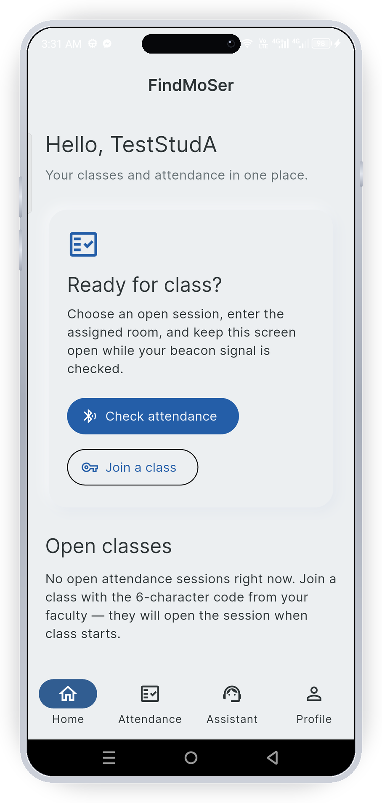
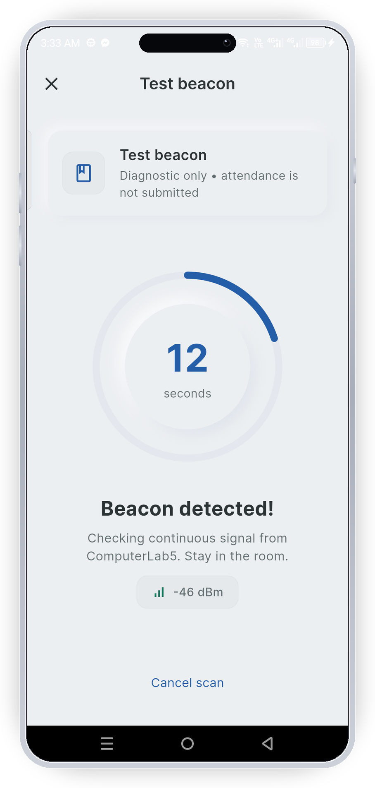
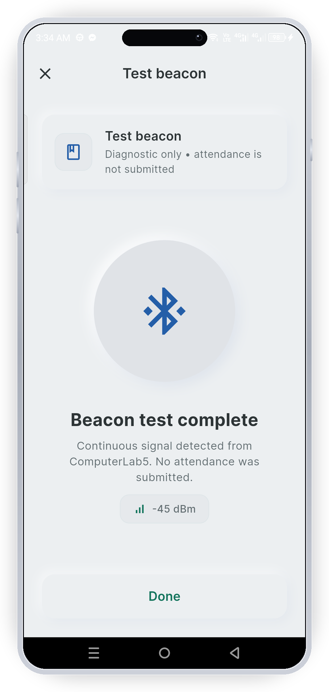
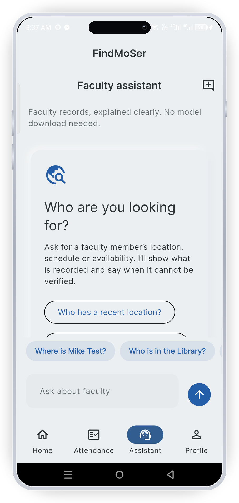
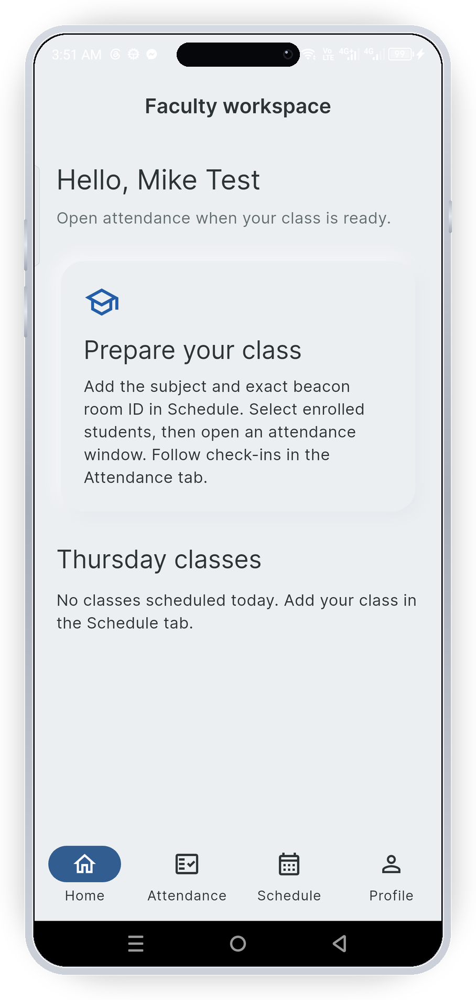
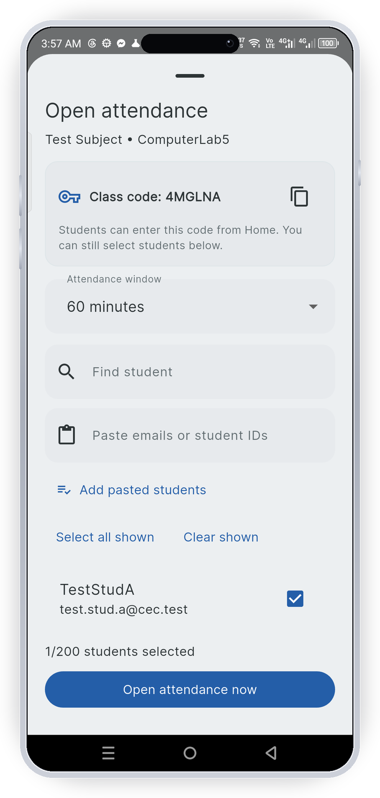
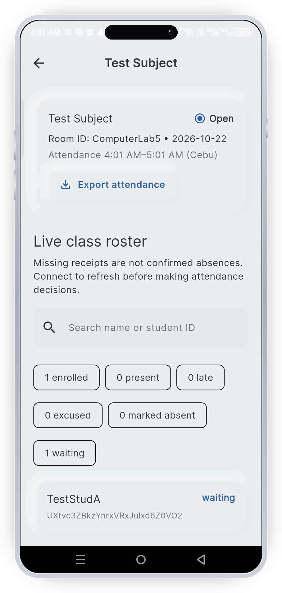
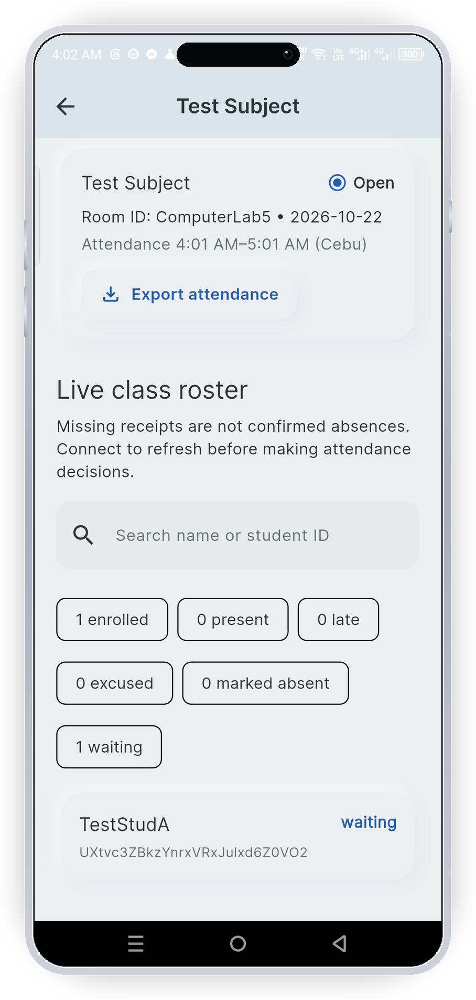
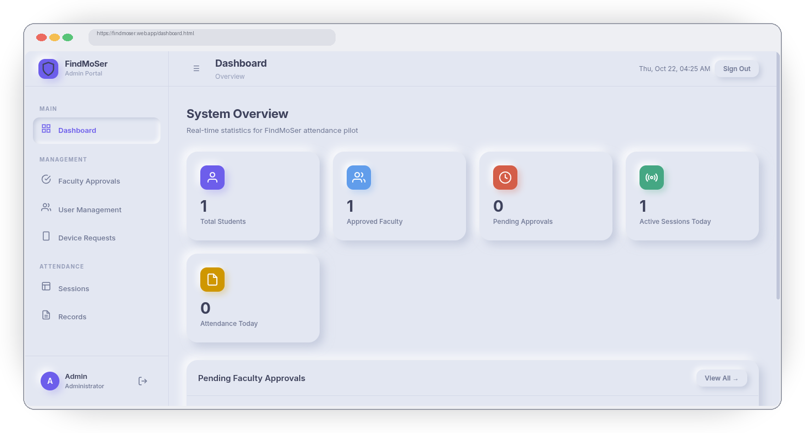
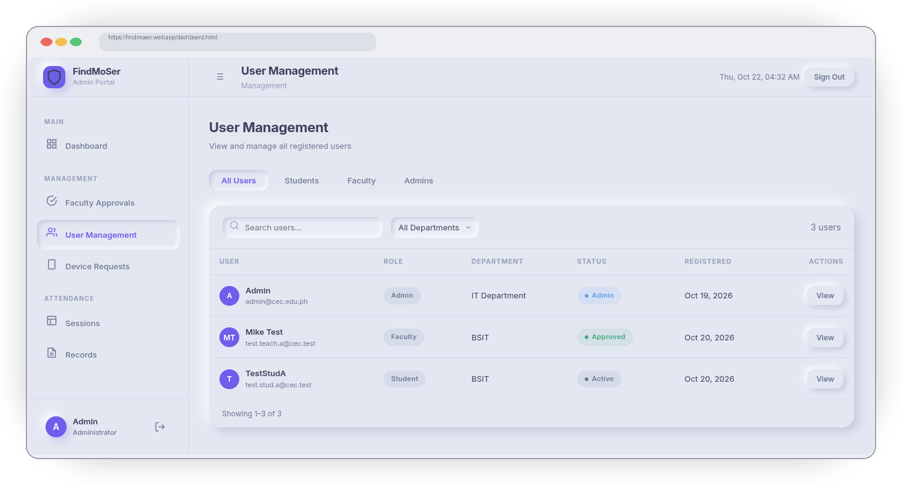

# FindMoSer

**BLE proximity-based student attendance system** — a Flutter Android app plus a Firebase admin console, backed by ESP32-C3 classroom beacons.


Proximity-based student attendance pilot for Cebu Eastern College, built with Flutter, Riverpod, Firebase Auth and Firestore. Six static ESP32 C3 Mini classroom beacons advertise names such as `FindMoSer_Room305`. The Android app performs the scan; the ESP32 does not run Flutter.

## Screenshots

> Real device captures from the Android app and the web admin console.

### Student app — check-in flow

| Home | Beacon scan | Result | Assistant |
|:---:|:---:|:---:|:---:|
|  |  |  |  |

### Faculty app — class & attendance management

| Home | Open attendance | Live roster | Audited marks |
|:---:|:---:|:---:|:---:|
|  |  |  |  |

### Admin console — Firebase-hosted web portal

| Dashboard | User management |
|:---:|:---:|
|  |  |

## Current workflow

- Faculty accounts require trusted operator approval (web console → Faculty Approvals). Faculty create schedules, enroll students (paste-in or 6-character class code, max 200) and open/close attendance windows; the default window follows the class period length.
- Students register one Android phone and tap a session card (button or the whole card) to start attendance. The scanner checks the exact room, a pilot -70 dBm threshold and 15 seconds of continuous fresh readings. Minimizing the app resets unfinished dwell and the screen warns on return.
- Test beacon is diagnostic only. It never creates an official record.
- Deterministic session/student IDs prevent duplicate student records. Firestore rules verify enrollment, session deadline, owner fields and registered device consistency.
- Receipts show pending, confirmed or rejected. A server timestamp is required for confirmation; a local outbox preserves pending/rejected state after restart. Cached copies are labeled.
- Faculty see live session rosters plus previous sessions, search enrollment, correct existing statuses with an immutable reason audit, record audited faculty marks (absent/late/excused) for enrolled students without receipts after closing, and export CSVs per session (absent rows included, with a Source column) or per class over a date range.
- Lost or replaced student phones go through Profile → Account Access; admins adjudicate on the web console (Device Requests) with one atomic, audited rebind. See [device registration and replacement](docs/device-binding.md).
- Display times use 12-hour AM/PM Cebu formatting; storage and CSV stay 24-hour. The student Assistant tab is a deterministic lookup of faculty presence — no AI service call.
- The active app uses soft neumorphic surfaces with labeled actions, readable text and reduced-motion support.

Device registration and BLE proximity reduce some casual misuse. They do **not** prove who is carrying a phone, authenticate static beacon broadcasts, or attest unmodified clients. Do not claim proxy-proof attendance.

## Tech stack

| Layer | Technology |
| --- | --- |
| Mobile app | Flutter, Dart, Riverpod |
| Auth & data | Firebase Authentication, Cloud Firestore |
| Rules | Firestore security rules (emulator-tested) |
| Hardware | ESP32-C3 Mini BLE beacons |
| Admin console | HTML/CSS/JS, Firebase Hosting |
| CI | GitHub Actions (Firebase Hosting deploy) |

## Develop and validate

Use Flutter stable with Dart >=3.12.2 and the Android SDK. The existing Firebase platform files point to a configured project; verify that project before deployment.

```sh
flutter pub get
flutter analyze
flutter test
npm ci --prefix test_rules
npm test --prefix test_rules
flutter build apk --release
```

Rules tests run solely against the `demo-findmoser` local emulator. Java 17 and a compatible Node runtime are required by the pinned Firebase test tools. Firebase rules are **not deployed** by tests or APK builds.

APK output: `build/app/outputs/flutter-apk/app-release.apk`. This repository currently signs release-mode APKs with the existing debug key for internal testing. Keep that same key for test updates because Android ID depends on signing identity. Before external production distribution, configure a private release key and a device-binding migration plan; do not silently change the signing key halfway through the pilot.

To capture sample-data UI previews:

```sh
PREVIEW_OUTPUT=/tmp/findmoser-ui-preview flutter test test/attendance_ui_test.dart
```

## Setup before school testing

Read [the attendance pilot guide](docs/attendance-pilot.md) for deployment (rules include `attendance_marks` and device-change adjudication), admin console setup, exact beacon names, test cases and thesis evidence. Read [device registration and replacement](docs/device-binding.md) for lost-phone rebinding via the admin Device Requests queue. To clear data between classroom runs run `npm run reset` from the parent folder (`node reset-data.js --devices` also frees phones for re-registration — never leave `serviceAccountKey.json` committed). Existing faculty accounts require `facultyApproved: true`; existing student hash IDs require review with the new APK. This intentionally fails closed until accounts and deployed rules match the new schema.

[Earlier locator notes](docs/legacy-locator-notes.md) are retained as historical context, not a description of the current attendance app. The existing Chapter 1/2 documents must be reframed and physical results collected before presenting attendance claims in Chapter 3.

## License

Source-available, **all rights reserved**. This project is original academic work by Mike Alinghawa. Viewing and referencing are permitted; copying, redistribution, modification, or submission as one's own work is not. See [LICENSE](LICENSE).
